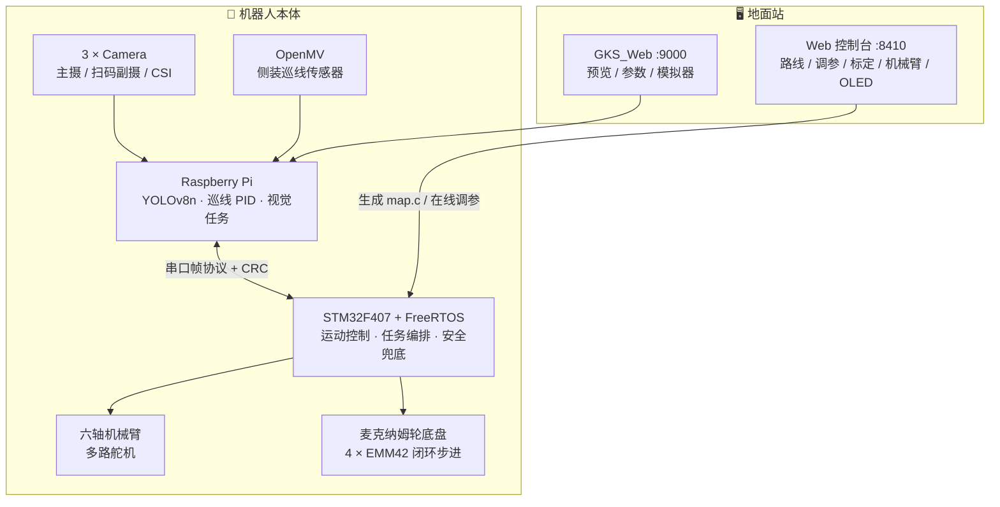
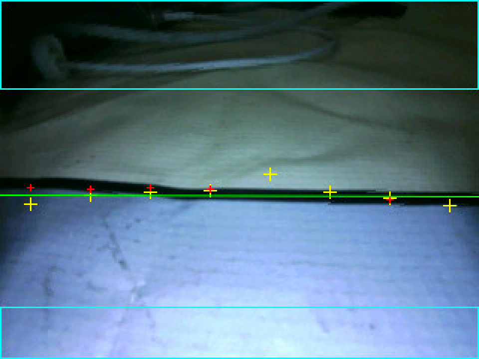

<h1 align="center">🤖 GongKeCompetition</h1>

<p align="center">
  <b>2026 年广东省工科大学生实验综合技能竞赛 · 排爆反恐救援机器人赛项</b><br>
  一台会看路、会扫码、会抓取、会打靶的自主救援机器人
</p>

<p align="center">
  
  
  
  
  
  
  
</p>

<p align="center">
  
</p>

<p align="center"><sub>▲ 3.5 m × 3.5 m 赛场示意：安全区 → 排爆区 → 反恐区 → 巡线返回</sub></p>

---

## 📖 项目简介

这是一套为「排爆反恐救援机器人」赛项从零搭建的完整比赛工程：**机械结构 + PCB + 嵌入式固件 + 树莓派视觉 + OpenMV 巡线 + 深度学习训练 + 上位机控制台**，全部代码与资料都在这个仓库里。

机器人以 **STM32F407 + FreeRTOS** 为实时控制核心，负责底盘运动、六轴机械臂、传感器与任务编排；**树莓派**负责视觉识别、相机管理与巡线 PID；**OpenMV** 作为独立巡线传感器；三颗相机分别承担主摄识别、二维码扫描和固定视角打靶。上位机提供 **11 个页签的 Web 控制台**，用来排路线、调参数、做标定、示教机械臂动作，甚至模拟一台单片机。

从安全扫码选路、巡线过弯，到色球 / 人质抓取、激光打靶，再到减速带与返回起点——整条比赛路线由 `map.c` 中一张**可编排的步骤表**驱动。改路线只改数据，不改执行器。

<p align="center">
  
  
  
  
  
</p>

| 指标 | 数字 |
|---|---|
| 代码规模 | 约 **8.6 万行**（固件 / 树莓派 / OpenMV / Web 控制台） |
| 路线预设 | **45 套**，控制台一键切换 |
| 相机 | **3 颗**（主摄 + 扫码副摄 + CSI 定焦） |
| 串口 | **6 路 UART**，DMA 收发 + 损坏自愈 |
| 控制台 | **11 个页签**，路线编排 / 调参 / 标定 / 机械臂 / OLED |
| 工程笔记 | **45 份 Markdown**，含 13 篇固件专题踩坑记录 |

---

## ✨ 核心能力

| | 能力 | 说明 |
|---|---|---|
| 🗺️ | **自主路线决策** | 扫三位二维码得到任务码，左右路线与任务组合由预设表切换；45 套路线可现场一键换图 |
| 🛣️ | **巡线与过弯** | OpenMV 侧装相机「距离剖面过零」测偏，树莓派 50 Hz PID，固件融合相机 / 陀螺仪 |
| 👥 | **人质识别与抓取** | YOLOv8n 三分类目标检测，机械臂单动作抓取，识别结果与坐标实时回传 |
| 🎯 | **激光打靶** | 三色靶环识别 + 20 Hz 流式跟踪 + 10 Hz 舵机闭环，激光定点命中 |
| 🔴 | **色球对位** | HSV 多帧投票 + 单应变换缺球推断，三球齐才执行抓取 |
| 🧱 | **全向底盘与越障** | 100 mm 麦克纳姆轮，雪弗板减速带缓慢顶越，EMM42 开环 / 闭环按需切换 |
| 🕹️ | **Web 控制台** | 路线可视化编排、在线调参、相机标定、机械臂示教、单片机模拟器 |
| 🧪 | **离线评估体系** | 靶标 / 二维码 / 巡线均有离线回放与跑分工具，先离线验证，再上真车 |

---

## 🏗️ 系统架构



三方之间只有两类契约：**串口帧协议**（`protocol.py` ↔ `docs/串口协议.md` ↔ 固件 `app_rpi.c`）和**参数登记表**（`config.py::EDITABLE_CONFIG`）。改任何一处，另外两处必须同步——这条纪律写进了每一份模块文档。

---

## 📂 仓库导览

| 目录 | 内容 |
|---|---|
| **`电控/`** | STM32F407 固件（CubeMX + FreeRTOS + 自研 QEPack 驱动）、11 页签 Web 控制台、13 篇固件专题文档 |
| **`视觉/PI/`** | 树莓派视觉工程 `GKS_Competition`（YOLO / 二维码 / 巡线 / 打靶 / 相机租约）与 Web 端 `GKS_Web` |
| **`视觉/OPENMV/`** | OpenMV 侧装巡线程序：距离剖面过零、丢线方向分类、拐角重拟合 |
| **`训练/`** | 人质 YOLOv8 训练脚本与数据集、OpenMV 巡线训练工具、15 份算法评审与复盘笔记 |
| **`模型/`** | SolidWorks / STEP / 3MF 结构模型、赛场地图与变式图 |
| **`PCB/`** | 自研集成板 EasyEDA 工程与原理图 |
| **`文档/`** | 赛项命题、评分标准、竞赛日程、设计报告与工科工程图 |
| **`现场/`** | 决赛文档与现场资料 |

---

## 🔧 硬件清单

| 子系统 | 选型 |
|---|---|
| 实时主控 | **STM32F407VET6** @168 MHz + FreeRTOS V11.3.0 |
| 视觉主控 | **Raspberry Pi**（Python 3 + OpenCV + YOLOv8n ONNX） |
| 巡线传感器 | **OpenMV**（侧装，按需发送文本帧） |
| 相机 | 2 × USB 1080p（主摄 / 扫码）+ 1 × CSI OV5647（固定视角打靶） |
| 底盘 | 100 mm 麦克纳姆轮 ×4 + EMM42 V5 闭环步进 |
| 机械臂 | 六轴机械臂，多路舵机驱动 |
| 电源 | 9000 mAh 锂电池 + 自研集成板 / 稳压板 |
| 交互 | OLED 菜单、实体按键、蓝牙、Web 控制台 |

---

## 🚀 快速开始

### 1. 编译并烧录固件

```bash
# 使用 Keil MDK5（ARMCC V5.06），打开工程后编译下载
电控/GongKeCompetition/MDK-ARM/GongKeCompetition.uvprojx

# 或命令行编译（UV4 退出码不反映成败，需看日志末行 N Error(s)）
cd 电控/GongKeCompetition/MDK-ARM
UV4.exe -b GongKeCompetition.uvprojx -j0 -o build.log
```

> ⚠️ `GongKeCompetition.uvprojx` 按仓库约定被 `.gitignore` 忽略。首次从仓库构建时，请用 CubeMX 打开 `GongKeCompetition.ioc` 重新生成工程，并把 `Application/app_*.c` 手动加入 `Application` 组。C 编译器 MiscControls 需包含 `--locale=C --diag_suppress=870`（源码为 UTF-8）。

### 2. 部署树莓派视觉端

```bash
# 1) 安装 udev 规则（按芯片版本号区分两个 CH340，换插口也不会认错）
sudo cp 视觉/PI/GKS_Competition/99-gks-devices.rules /etc/udev/rules.d/
sudo udevadm control --reload-rules && sudo udevadm trigger

# 2) 安装依赖并启动
sudo apt install python3-opencv python3-numpy python3-serial
cd 视觉/PI/GKS_Competition
python3 main.py

# 3) 开机自启
sudo cp gks.service /etc/systemd/system/
sudo systemctl daemon-reload && sudo systemctl enable --now gks.service
```

现场参数以 `config_override.json` 为准——出厂值只作参考，判断实际行为前先读它。

### 3. 打开 Web 控制台

```bash
# Windows：双击
电控/GongKeCompetition/webconsole.bat
# 或
python 电控/GongKeCompetition/tools/webconsole/server.py
```

浏览器访问 `http://localhost:8410`，即可进行路线编排、参数调整、相机标定、机械臂示教与单片机模拟。

> 🔐 **安全提示**：控制台刻意无鉴权并绑定 `0.0.0.0`，方便队友在局域网内共同调试。请只在可信网络中使用；在不可控场地请把 `server.BIND_HOST` 改为 `127.0.0.1`。

### 4. 运行 OpenMV 巡线

用 OpenMV IDE 打开 `视觉/OPENMV/main.py`，连接相机后运行。OpenMV 按需发送：收到树莓派的 `G` 开始输出 `L,<offset>,<angle>,<valid>` 文本帧，收到 `S` 停止。

---

## 🧠 几个值得说的技术点

### 1. 二维码：先「看得见」，再「解得开」

赛道上的二维码经常是**斜视、低分辨率、强透视**的。新扫码引擎把「zxing 解不出」的检测框当作检测器：紧裁 1.6 倍 → 放大到 960 → CLAHE 增强 → 多二值化器重试。现场真帧基线从 **2/10 提升到 10/10**。

面对最难的图，还有一套自研解码器：**几何重建 + 候选集码字匹配**。它只认 Version 1（21×21），在赛题固定的 27 种三位码候选集里做 RS 码字精确匹配——零新增依赖，纯 Python + OpenCV，几何错位只会「解不出」，不会「解出一个错的数」。

### 2. 靶心定位与流控闭环

三色靶盘识别不是「找最像的色块」，而是四条判据层层过滤：

- **环内径比 q**（内孔半径 ÷ 外接圆半径）：设计值 0.55，现场真靶 0.52~0.55，背景杂块 ≤0.23，两者不重叠；
- **跨色尺寸一致性**：在候选里挑一组尺寸匹配的靶，而不是各色取最大；
- **内边界优先**：实拍外缘是手工波浪边，内孔是干净圆，圆心以内边界为准；
- **包围盒局部掩膜**：逐候选只在自身 bbox 内处理，整帧耗时从 ~1.0 s 降到 ~0.22 s。

识别之后进入**流控闭环**：树莓派在动态跟踪窗内以 ~20 Hz 回传靶心，单片机以 ~10 Hz 的 P 环微调舵机，直到收敛或超时。离线回放 41 例评估中，三靶定位中位误差约 **0.26 mm**、95 分位约 **0.66 mm**。

### 3. 巡线不靠「猜」

早期方案用最大色块的 `rotation` 当航向角，光照一变就翻号。现在的测量核心是**上下参考色的距离剖面过零**：每条横条计算到上下参考色的色度距离差，取过零点作为交界位置——阴影把色度压向原点也不翻面，黑条不再把落差劈成两半。

丢线时不是简单地「不走了」：OpenMV 会把零星交界点的行位置与两侧参考色距离做两级判别，告诉树莓派线丢在画面的上方、下方还是不明，树莓派据此**定向找线**。树莓派以 50 Hz 下发 PID 转向，固件侧融合相机与陀螺仪，并处理启动盲期的陈帧问题。

### 4. 固件是「可编排」的

比赛现场改路线是常态，所以固件把「流程顺序」从代码里抽成数据表：

```c
/* map.c 行格式范例 */
SCRIPT_STEP    (STEP_WAIT_HANDSHAKE,      "等待握手"),                        // ucRpiHandshake()
SCRIPT_STEP_I1 (STEP_QR_SCAN_WAIT,        "二维码扫描",    8000),             // ucRpiQrScan()
SCRIPT_STEP_I1 (STEP_SCRIPT_CALL,         "执行任务一",    SCRIPT_PRESET_43), // vScriptCallPreset()
```

- **45 套预设路线**，`map.c` 是一张张纯数据表；
- **就地嵌套的 IF / ELSE / END_IF**，不占预设、不需要栈，任意层嵌套；
- **CALL / RETURN** 复用公共路线段，带深度上限兜底；
- Web 控制台直接生成 `map.c` / `map.h`，积木的参数注释以 DSL 形式反哺界面；
- 跨模块状态统一走 **Beam**，禁止裸 `extern` 全局变量；
- **6 路 UART** 全部 DMA 收发，RX 有三层兜底（IDLE 卡死检测、错误回调、5 s 重装），TX 走 DMA 环 + TC 中断链。

这些规则不是「写得漂亮」，而是被现场故障一条条逼出来的——全部沉淀在 `电控/GongKeCompetition/CLAUDE.md` 与 `docs/` 的 13 篇专题里。

---

## 🖼️ 镜头里的一些瞬间

<table>
  <tr>
    <td width="50%" align="center">
      
      <br><sub>三色靶盘识别：环心定位与瞄准点</sub>
    </td>
    <td width="50%" align="center">
      
      <br><sub>巡线测量：参考色带、交界点与拟合直线</sub>
    </td>
  </tr>
</table>

---

## 📚 文档索引

这个仓库最值得看的，除了代码，还有**踩坑记录**。

| 文档 | 内容 |
|---|---|
| [`电控/GongKeCompetition/CLAUDE.md`](电控/GongKeCompetition/CLAUDE.md) | 固件全局铁律、目录结构、中断与并发、脚本设计规则 |
| [`电控/GongKeCompetition/docs/`](电控/GongKeCompetition/docs/) | 13 篇专题：UART / Pi 链路 / 蓝牙协议 / 巡线 / 标靶 / 抓取 / 看路 / OLED / 传感器 / 底盘 / 控制台元数据 / 审查记录 |
| [`视觉/PI/GKS_Competition/CLAUDE.md`](视觉/PI/GKS_Competition/CLAUDE.md) | 树莓派端「坑位地图」：相机租约、CSI 持有、任务线程、链路自愈 |
| [`视觉/PI/GKS_Competition/docs/串口协议.md`](视觉/PI/GKS_Competition/docs/串口协议.md) | 双端串口帧契约：命令表、结果帧、CRC 与 Tag 分配 |
| [`视觉/PI/GKS_Web/CLAUDE.md`](视觉/PI/GKS_Web/CLAUDE.md) | Web 端：预览、参数页、模拟器、WiFi 切换 |
| [`文档/设计报告/设计报告.pdf`](文档/设计报告/设计报告.pdf) | 赛项设计报告 |

---

## 📄 License

本项目基于 [Apache License 2.0](LICENSE) 开源。欢迎学习、参考与交流。

---

<div align="center">

## 💌 写在最后

写到这里，比赛其实已经接近尾声了。

这大概是我大学生涯里最后一场比赛。

从第一行 `HAL_Init()` 到最后一版 `map.c`，从调不通的串口到凌晨三点还在跳的巡线数据，从第一次机械臂抓空到最后一发激光命中——这台车身上，藏着很多个不想睡的夜晚，也藏着我们一点点把「不会」变成「会」的过程。

比赛会结束，但那些在噪声里找信号、在失败里复盘、把复杂问题一层层拆开的夜晚不会白费。愿我们带着在这里学到的东西，走向更大的赛场；也愿每一个正在为某件事全力以赴的人，都能被自己的坚持温柔以待。

**最后一战，全力以赴，不留遗憾。**

愿所有的努力，都有回响。🌟

</div>
