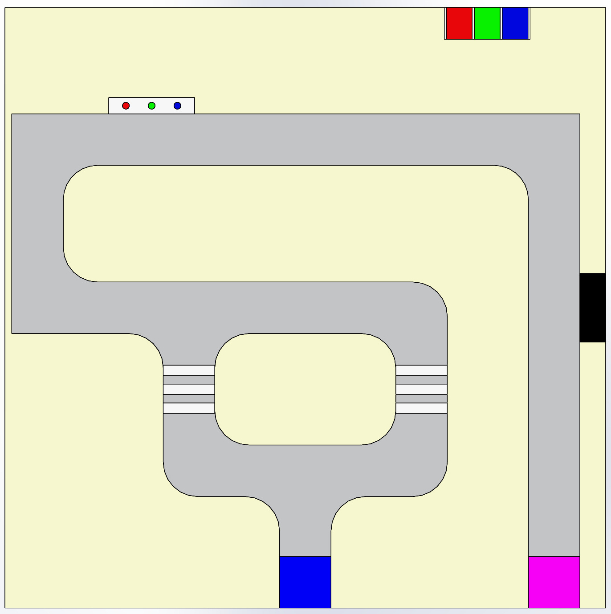
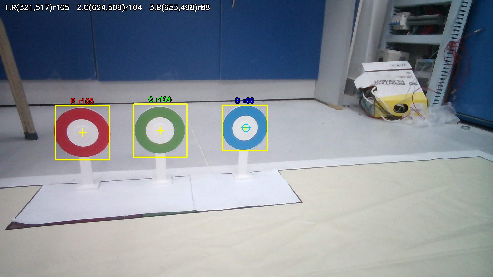
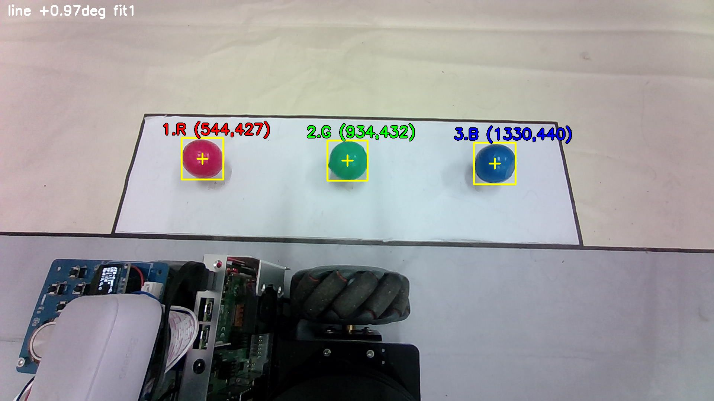

# 🤖 GongKeCompetition

2026 年广东省工科大学生实验综合技能竞赛 · 排爆反恐救援机器人赛项

这是本次比赛的参赛工程，包含机器人固件、树莓派视觉、OpenMV 巡线、YOLOv8 训练、机械结构、PCB 和上位机控制台。

比赛任务大致是：从出发区扫码拿到任务码，按码选择左右路线，沿途完成排爆区的色球抓取、反恐区的人质识别与抓取、靶标区的激光打靶，最后越过减速带返回终点。机器人采用四轮麦克纳姆轮底盘和六轴机械臂，STM32F407 负责实时控制，树莓派负责视觉识别，OpenMV 作为独立巡线传感器。

<p align="center">
  
</p>

<p align="center"><sub>3.5 m × 3.5 m 赛场示意</sub></p>

<table>
  <tr>
    <td width="50%" align="center">
      
      <br><sub>三色靶盘识别：环心定位与瞄准点</sub>
    </td>
    <td width="50%" align="center">
      
      <br><sub>色球识别：三色掩膜、检测框与球心定位</sub>
    </td>
  </tr>
</table>

## 📁 目录结构

| 目录             | 内容                                                                        |
| ---------------- | --------------------------------------------------------------------------- |
| `电控/`        | STM32F407 固件（CubeMX + FreeRTOS + QEPack 驱动）、Web 控制台、固件专题文档 |
| `视觉/PI/`     | 树莓派视觉工程 `GKS_Competition` 和 Web 端 `GKS_Web`                    |
| `视觉/OPENMV/` | OpenMV 侧装巡线程序                                                         |
| `训练/`        | 人质 YOLOv8 训练脚本与数据集、OpenMV 巡线训练工具、调试记录                 |
| `模型/`        | SolidWorks / STEP / 3MF 结构模型、赛场地图与变式图                          |
| `PCB/`         | 集成板 EasyEDA 工程与原理图                                                 |
| `文档/`        | 赛项命题、评分标准、竞赛日程、设计报告与工程图                              |
| `现场/`        | 决赛文档与现场资料                                                          |

## 🔧 硬件

| 部分   | 型号 / 说明                                                    |
| ------ | -------------------------------------------------------------- |
| 主控   | STM32F407VET6 @168 MHz，FreeRTOS V11.3.0                       |
| 视觉   | Raspberry Pi（Python 3 + OpenCV + YOLOv8n ONNX）               |
| 巡线   | OpenMV，侧装，按需发送文本帧                                   |
| 相机   | 2 路 USB 1080p（主摄 / 扫码）+ 1 路 CSI OV5647（固定视角打靶） |
| 底盘   | 100 mm 麦克纳姆轮 ×4，EMM42 V5 闭环步进                       |
| 机械臂 | 六轴机械臂，多路舵机驱动                                       |
| 电源   | 9000 mAh 锂电池，自研集成板与稳压板                            |
| 交互   | OLED 菜单、实体按键、蓝牙、Web 控制台                          |

## 🚀 运行

### 固件

用 Keil MDK5（ARMCC V5.06）打开 `电控/GongKeCompetition/MDK-ARM/GongKeCompetition.uvprojx`，编译下载。命令行编译：

```bash
cd 电控/GongKeCompetition/MDK-ARM
UV4.exe -b GongKeCompetition.uvprojx -j0 -o build.log
```

UV4 的退出码不反映编译成败，需要看日志最后一行的 `N Error(s)`。

`GongKeCompetition.uvprojx` 被 `.gitignore` 忽略。从仓库重新构建时，用 CubeMX 打开 `GongKeCompetition.ioc` 生成工程，再把 `Application/app_*.c` 手动加入 `Application` 组。C 编译器 MiscControls 需要带 `--locale=C --diag_suppress=870`，否则源码里的中文注释在 AC5 下可能报引号错误。

### 树莓派视觉

```bash
# udev 规则：按芯片版本号区分两个 CH340，换插口也不会认错
sudo cp 视觉/PI/GKS_Competition/99-gks-devices.rules /etc/udev/rules.d/
sudo udevadm control --reload-rules && sudo udevadm trigger

# 依赖与启动
sudo apt install python3-opencv python3-numpy python3-serial
cd 视觉/PI/GKS_Competition
python3 main.py

# 开机自启
sudo cp gks.service /etc/systemd/system/
sudo systemctl daemon-reload && sudo systemctl enable --now gks.service
```

现场参数以 `config_override.json` 为准，`config.py` 里的出厂值只作参考。

### Web 控制台

```bash
# Windows 下直接双击
电控/GongKeCompetition/webconsole.bat

# 或者手动启动
python 电控/GongKeCompetition/tools/webconsole/server.py
```

浏览器打开 `http://localhost:8410`。控制台可以编排路线、调参数、做相机标定、示教机械臂动作，也可以启动单片机模拟器。

控制台没有鉴权，并且绑定在 `0.0.0.0`，方便局域网内队友一起调试。只建议在可信网络里使用；如果场地网络不可控，把 `server.BIND_HOST` 改成 `127.0.0.1`。

### OpenMV

用 OpenMV IDE 打开 `视觉/OPENMV/main.py`，连接相机后运行。OpenMV 默认不发数据，收到树莓派的 `G` 后开始输出 `L,<offset>,<angle>,<valid>` 文本帧，收到 `S` 停止。

## ⚙️ 实现说明

### 路线表

固件把比赛流程从代码里抽成了数据表。一条路线就是 `map.c` 里的一组步骤，改路线只改表，不改执行器：

```c
/* map.c 行格式范例 */
SCRIPT_STEP    (STEP_WAIT_HANDSHAKE,      "等待握手"),                        // ucRpiHandshake()
SCRIPT_STEP_I1 (STEP_QR_SCAN_WAIT,        "二维码扫描",    8000),             // ucRpiQrScan()
SCRIPT_STEP_I1 (STEP_SCRIPT_CALL,         "执行任务一",    SCRIPT_PRESET_43), // vScriptCallPreset()
```

`map.c` 里目前有 45 套预设，可以在控制台里切换。条件分支直接在步骤表里写 `STEP_IF / STEP_ELSE / STEP_END_IF`，三块标记按位置配对，不占预设，也能任意嵌套。`STEP_SCRIPT_CALL / STEP_SCRIPT_RETURN` 用来复用公共路线段，带深度上限兜底。

Web 控制台会直接生成 `map.c` 和 `map.h`。积木的参数注释以一种简单的 DSL 写在 `app_script.h` 里，控制台解析后用于显示参数名、单位和下拉选项。

### 二维码

新扫码引擎把 zxing 检测到、但解不出的二维码框当作检测器：先按检测框紧裁 1.6 倍，再放大到 960，做 CLAHE 增强，然后换几种二值化器重试。现场真帧的识别率从 2/10 提升到 10/10。

另外有一套自研解码器，专门处理斜视、低分辨率、强透视的图：先做几何重建，再在已知候选集里做 RS 码字匹配。它只认 Version 1（21×21），候选集是赛题固定的 27 种三位码；几何错位只会解不出来，不会解出一个错误的数。整套实现只依赖 OpenCV 和 numpy，没有新增第三方依赖。

### 靶标与射靶

靶盘识别主要靠四条判据：

- **环内径比 q**：内孔拟合半径 ÷ 外接圆半径。靶盘设计值 0.55，现场实测真靶 0.52~0.55，背景杂块基本不超过 0.23。
- **跨色尺寸一致性**：在候选里挑一组尺寸匹配的靶，而不是每个颜色各取最大。
- **内边界优先**：实拍外缘是手工贴的波浪边，内孔是干净的圆，所以圆心以内边界为准。
- **包围盒局部掩膜**：每个候选只在自己的 bbox 里做处理。整帧耗时从约 1.0 s 降到约 0.22 s。

识别之后进入流控闭环：树莓派在动态跟踪窗里以约 20 Hz 回传靶心，单片机以约 10 Hz 的 P 环微调舵机，直到收敛或超时。离线回放的 41 个用例里，三靶定位中位误差约 0.26 mm，95 分位约 0.66 mm。

### 巡线与色球

巡线用侧装 OpenMV。图像按横向条带切分，计算每条到上下参考色的色度距离差，取过零点作为交界位置。这个方法对阴影和黑条不敏感，比早期直接取色块主轴稳定很多。丢线时，OpenMV 会根据零星交界点的行位置和两侧参考色距离判断线丢在画面上方、下方还是不明，树莓派据此定向找线。树莓派以 50 Hz 下发 PID 转向，固件侧融合相机与陀螺仪。

色球识别用 HSV 三色掩膜加多帧投票，凑满三颗才继续。只认出两颗时，会用板子四角做单应变换，按球在板上的固定位置把缺的那颗推回来；推断不成立就报失败，不会硬算。

### 固件细节

- 6 路 UART，接收走 DMA 循环 + IDLE 中断，发送走 DMA 环 + TC 中断链。
- 接收侧有三层兜底：IDLE 卡死检测、`HAL_UART_ErrorCallback`、以及树莓派链路的 5 s 重装。
- 跨模块共享状态统一放在 `app_beam.c`，外部只能通过 getter/setter 访问，不在各模块头文件里加裸 `extern`。
- 业务 1 ms 中断只做舵机平滑和按键扫描，角度 PID 由独立任务以 50 ms 周期运行。
- 中断优先级、临界区里能不能发串口、哪些 HAL 函数不能在 ISR 里调，这些规则都写在 `电控/GongKeCompetition/CLAUDE.md` 里。

### 控制台实现

Web 控制台基于 Python 标准库实现，前端是原生 JS，一共 11 个页签：地图、调参、位移、自定义、标定、采集、调试助手、蓝牙、机械臂、底盘动作组、OLED。它会把路线、参数、标定和机械臂动作直接写回仓库源文件，多客户端之间用版本号和 409 乐观锁同步。另有一个无头单片机模拟器，没接实车时也能在页面上发指令调试。

## 📚 文档

| 文档                                                                                    | 内容                                                                                               |
| --------------------------------------------------------------------------------------- | -------------------------------------------------------------------------------------------------- |
| [`电控/GongKeCompetition/CLAUDE.md`](电控/GongKeCompetition/CLAUDE.md)                 | 固件全局规则、目录结构、中断与并发、脚本设计                                                       |
| [`电控/GongKeCompetition/docs/`](电控/GongKeCompetition/docs/)                         | 13 篇专题：UART、Pi 链路、蓝牙、巡线、标靶、抓取、看路、OLED、传感器、底盘、控制台元数据、审查记录 |
| [`视觉/PI/GKS_Competition/CLAUDE.md`](视觉/PI/GKS_Competition/CLAUDE.md)               | 树莓派端相机租约、CSI 持有、任务线程、链路自愈                                                     |
| [`视觉/PI/GKS_Competition/docs/串口协议.md`](视觉/PI/GKS_Competition/docs/串口协议.md) | 双端串口帧协议：命令表、结果帧、CRC 与 Tag 分配                                                    |
| [`视觉/PI/GKS_Web/CLAUDE.md`](视觉/PI/GKS_Web/CLAUDE.md)                               | Web 端：预览、参数页、模拟器、WiFi 切换                                                            |
| [`文档/设计报告/设计报告.pdf`](文档/设计报告/设计报告.pdf)                             | 赛项设计报告                                                                                       |

## 📄 License

本项目基于 [Apache License 2.0](LICENSE) 开源。

## 🗯写在最后

这里借用工创赛项目Logistics_Vehicle的一句话：

*	创新是时代赋予你们的神圣使命，别害怕打破传统的枷锁，以果敢的决心冲破陈规陋习，用全新的视角看待问题，敢于在别人未涉足之地留下你们的足迹。我们留下的经验、智慧以及未竟的事业，都是给你们的礼物。希望你们能在这片土地上肆意挥洒汗水，自由驰骋，发挥出你们独特的创造力与才华，开拓出属于你们自己的辉煌天地。*
