# 🤖 GongKeCompetition

2026 年广东省工科大学生实验综合技能竞赛 · 排爆反恐救援机器人赛项

这是本次比赛的参赛工程，包含机器人固件、树莓派视觉、OpenMV 巡线、YOLOv8 训练、机械结构、PCB 和上位机控制台。

比赛任务大致是：从出发区扫码拿到任务码，按码选择左右路线，沿途完成排爆区的色球抓取、反恐区的人质识别与抓取、靶标区的激光打靶，最后越过减速带返回终点。机器人采用四轮麦克纳姆轮底盘和六轴机械臂，STM32F407 负责实时控制，树莓派负责视觉识别，OpenMV 作为独立巡线传感器。

<p align="center">
  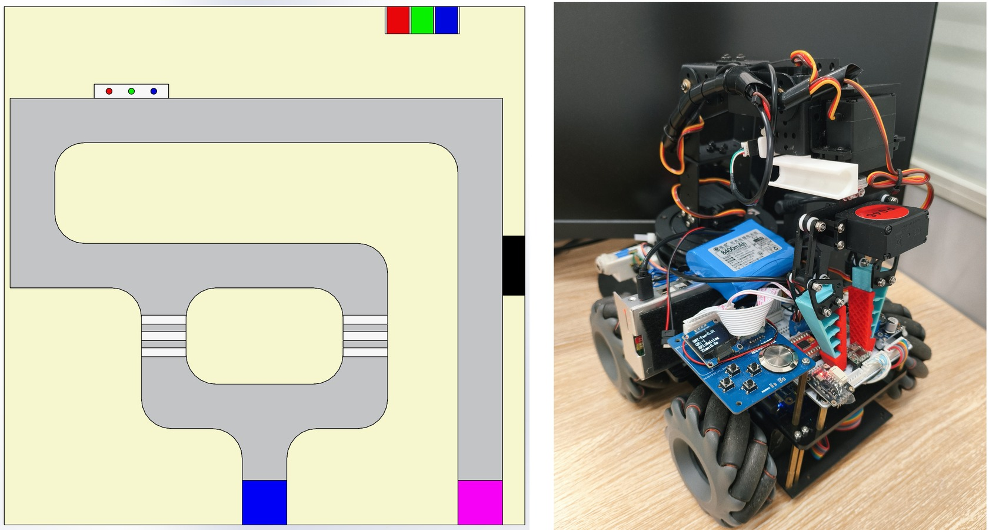
</p>
<p align="center"><sub>左：赛场地图示意　右：整车实物</sub></p>

## ⚙️ 实现说明

这一段重点写上位机。

比赛现场留给调试的时间很少。如果每次改路线、改参数、标定相机、录机械臂动作都要改 C 代码再编译，时间根本不够。所以这套工程把「流程」和「参数」从固件里搬了出来，做成上位机可以直接读写的数据。

上位机是 `电控/GongKeCompetition/tools/webconsole/` 下的本地 Web 控制台：Python 标准库 + 原生 JS，双击 `webconsole.bat` 后浏览器打开 `:8410`。它没有 Flask/Django 之类的外部框架依赖，所有读写都直接落在仓库里的源文件和 JSON 清单上；多个人同时开页面时，用版本号和 409 乐观锁避免互相覆盖。

控制台围绕三份源码工作：

- `map.c`：路线表，一行一个步骤。
- `app_script.h`：步骤的参数注释 DSL，控制台据此生成积木库、参数名、单位和下拉选项。
- `app_config.h`：`#define` 的尾注释，控制台据此生成「调参」页的分组、显示名、范围和换算。

这三份文件是唯一数据源，控制台不维护另一套路线/参数数据库。改完保存，源码就变了；Keil 重新编译烧录即可。

### 十一个 Tab

| Tab | 作用 |
|---|---|
| 地图 | 积木化编辑 `map.c`：拖步骤、改参数、加 `IF/ELSE`、调用子预设、整块禁用；保存时同时生成 `map.h` 的预设枚举。 |
| 调参 | 把 `app_config.h` 的 `#define` 变成可调参数，分组、显示名、单位、范围和换算都来自尾注释；写回时保持原类型。 |
| 位移 | 管理路线里的 `MOVE_*` 位移变量，并配一张赛场示意图，把变量和地图上的路段对应起来。 |
| 自定义 | 新建 `STEP_IF` 的编译期条件开关，一次改三处：宏、枚举、求值 getter，地图里立刻能选。 |
| 标定 | 按主摄个体保存/切换 19 个标定宏，一台相机一套预设，换相机不用重新手抄参数。 |
| 采集 | 摄像头预览 + 分类采集，直接给 YOLOv8 数据集攒图。 |
| 调试助手 | 一键连树莓派：更新 SSH/网络位置、远程桌面、远程文件夹、远程 VSCode、常用命令。 |
| 蓝牙 | 通过蓝牙串口在线读写固件 Beam 参数、点动机械臂；参数面板完全由设备上报，不在 PC 端写死。 |
| 机械臂 | 拖滑杆录位姿，存成动作预设；保存后在地图里变成一块大积木，可直接拖进路线。 |
| 底盘动作组 | 用时间轴把平移、转弯、臂动作叠加成一组底盘动作，固件按 20 ms 一拍混合播放。 |
| OLED | 编辑 OLED 菜单表和子菜单，右侧 128×64 预览；缺汉字时自动补字模。 |

<table>
  <tr>
    <td width="50%" align="center">
      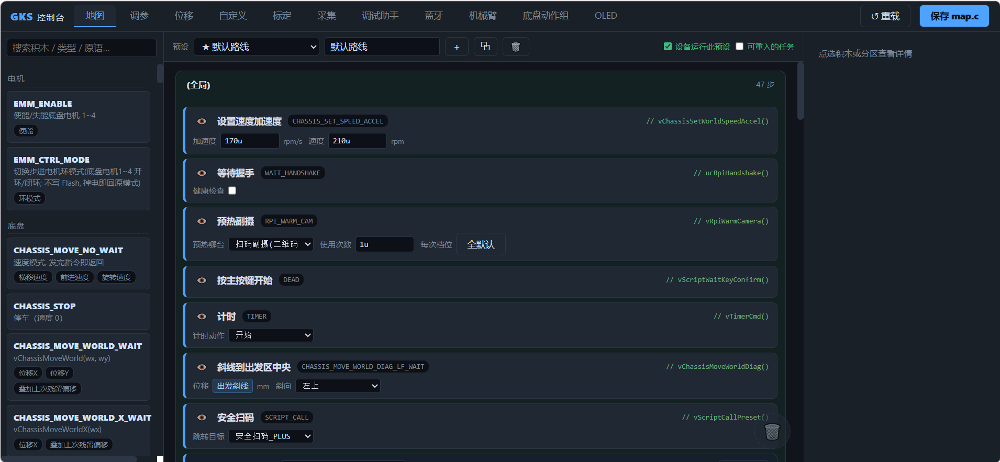
      <br><sub>地图：积木化编辑路线</sub>
    </td>
    <td width="50%" align="center">
      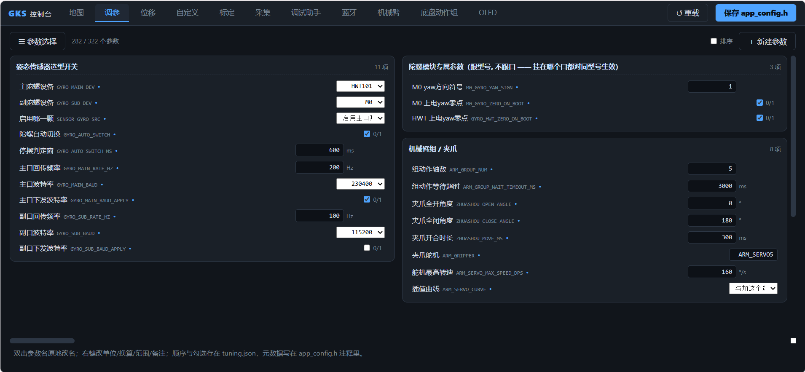
      <br><sub>调参：宏参数在线调整</sub>
    </td>
  </tr>
  <tr>
    <td width="50%" align="center">
      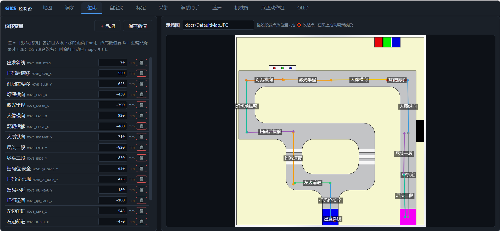
      <br><sub>位移：路线位移与示意图</sub>
    </td>
    <td width="50%" align="center">
      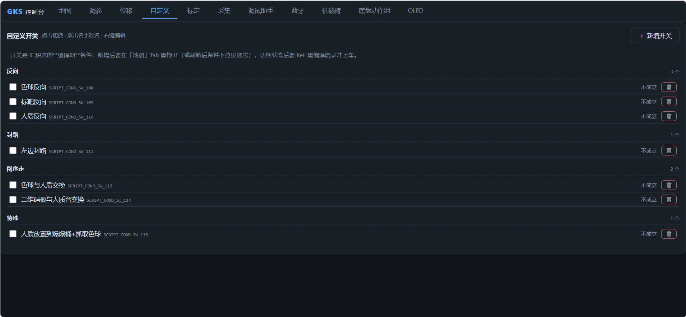
      <br><sub>自定义：IF 条件开关</sub>
    </td>
  </tr>
  <tr>
    <td width="50%" align="center">
      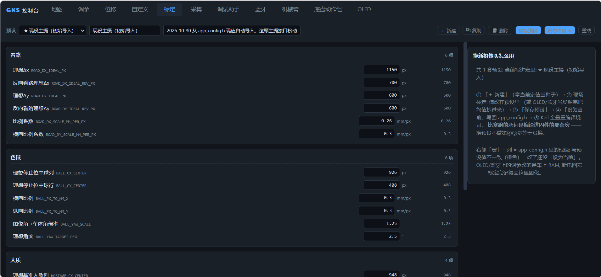
      <br><sub>标定：一台主摄一套预设</sub>
    </td>
    <td width="50%" align="center">
      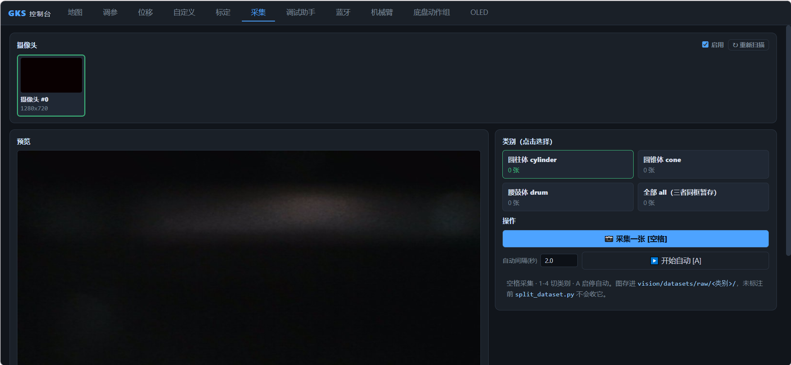
      <br><sub>采集：YOLO 数据集采集</sub>
    </td>
  </tr>
  <tr>
    <td width="50%" align="center">
      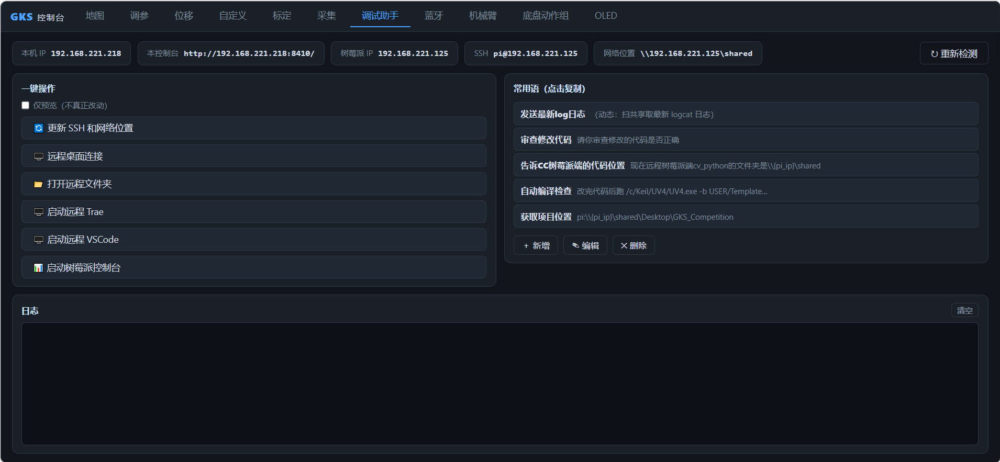
      <br><sub>调试助手：树莓派联机工具</sub>
    </td>
    <td width="50%" align="center">
      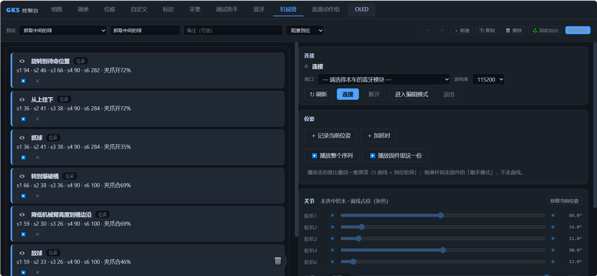
      <br><sub>机械臂：位姿示教与动作预设</sub>
    </td>
  </tr>
  <tr>
    <td colspan="2" align="center">
      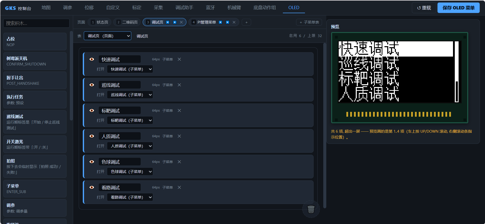
      <br><sub>OLED：菜单表与 128×64 预览</sub>
    </td>
  </tr>
</table>

截图里的「地图」页正在编辑默认路线，一共 47 步；左边是积木库，中间是路线，右边是选中步骤的参数详情。

### 为什么能快速复用到其他小车题目

这套东西不是只为这一道题写的。把赛题拆开看，绝大多数小车题都是「移动 → 识别 → 执行机构动作」的组合。控制台把这三种东西都变成了可视化数据：

1. **移动**：`app_chassis.c` 里的原语（世界系平移、支点/原地转弯、巡线收敛）如果够用，直接在「地图」里拖；不够就加一个 `STEP_*` 和对应动作函数。
2. **识别**：树莓派/OpenMV 返回结果帧，固件侧包成一个 `STEP_*_WAIT`，控制台里就是一块积木；相机预热、结果超时、失败分支都在步骤表里排。
3. **执行机构**：机械臂动作、底盘动作组、OLED 菜单都是数据表，控制台负责录制/生成；换一个夹爪或云台，改的是表，不是调度逻辑。

所以换题时通常只需要做四件事：接上新的传感器/执行器 → 在 `app_script.h` 写参数注释 → 在 `app_config.h` 写可调宏 → 在控制台里排路线、标定、示教。调度器、串口协议、参数读写、模拟器都不用重写。

当然，前提是题目还能拆成步骤。如果控制架构完全不同，还是要改执行器。

### 视觉任务

视觉任务也走同一套接口。树莓派负责识别，结果通过串口结果帧回传；固件侧只看到「一个阻塞步骤 + 一个超时」。下面几张是比赛现场的实际识别画面：

<table>
  <tr>
    <td width="50%" align="center">
      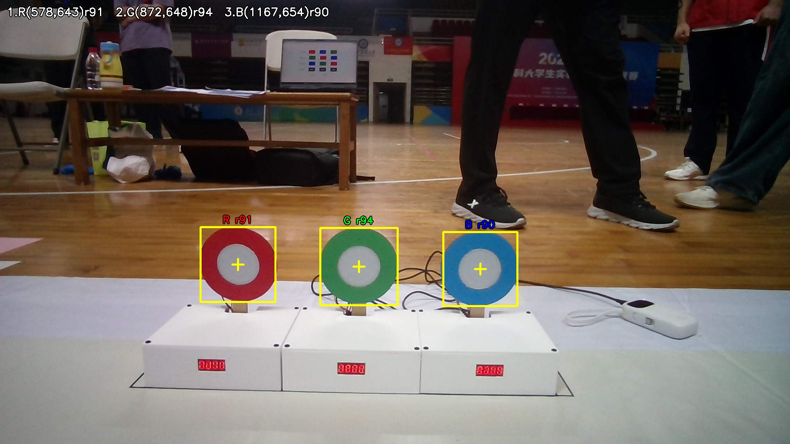
      <br><sub>靶标：三色靶环 + 靶心定位</sub>
    </td>
    <td width="50%" align="center">
      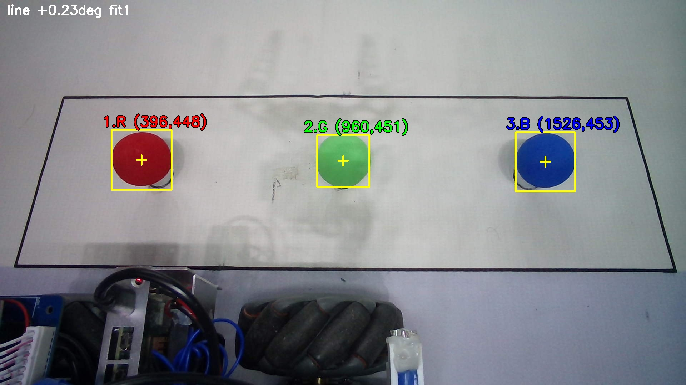
      <br><sub>色球：HSV 三色掩膜 + 多帧投票</sub>
    </td>
  </tr>
  <tr>
    <td width="50%" align="center">
      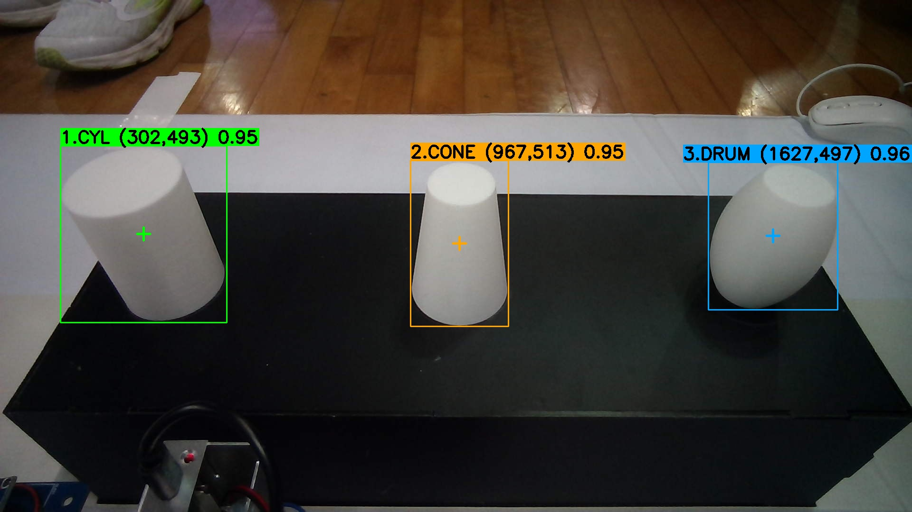
      <br><sub>人质：YOLOv8n 三分类（圆柱 / 圆锥 / 腰鼓）</sub>
    </td>
    <td width="50%" align="center">
      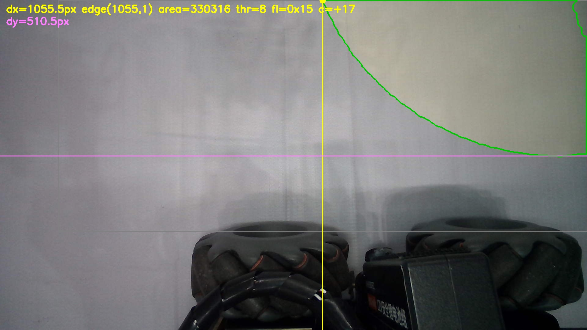
      <br><sub>看路：黄区边缘 + 横向/纵向偏差</sub>
    </td>
  </tr>
</table>

二维码有两条链路：常规图走 zxing + 裁剪/放大/CLAHE 重试，斜视或低分辨率图走自研几何重建 + 候选集匹配。巡线由 OpenMV 做距离剖面过零，树莓派以 50 Hz 下发 PID 转向，固件侧融合相机和陀螺仪。打靶识别用环内径比、跨色尺寸一致性、内边界圆心三条判据锁定靶盘，再由 20 Hz 靶心流和 10 Hz 舵机 P 环完成闭环。

### 树莓派 Web 端

除了 PC 端控制台，树莓派上还有一套独立的 GKS_Web（`:9000`），负责相机预览、参数、日志和单片机模拟器。两个进程互不影响，比赛时可以用手机或另一台电脑看画面、发指令。

<table>
  <tr>
    <td width="50%" align="center">
      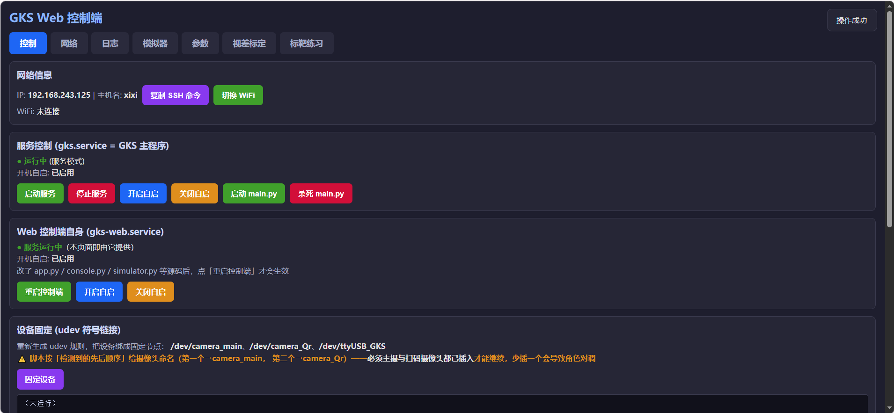
      <br><sub>控制区：main.py / 服务 / 电源</sub>
    </td>
    <td width="50%" align="center">
      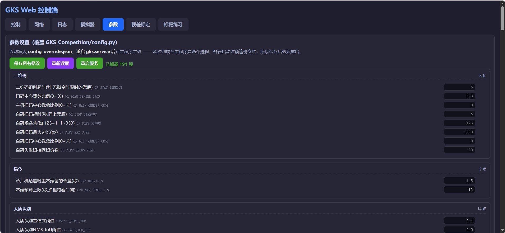
      <br><sub>参数区：在线改视觉参数</sub>
    </td>
  </tr>
  <tr>
    <td width="50%" align="center">
      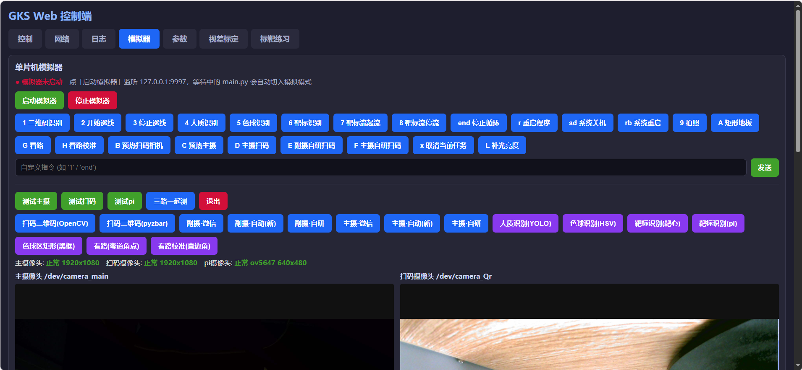
      <br><sub>模拟器：没接实车也能发指令</sub>
    </td>
    <td width="50%" align="center">
      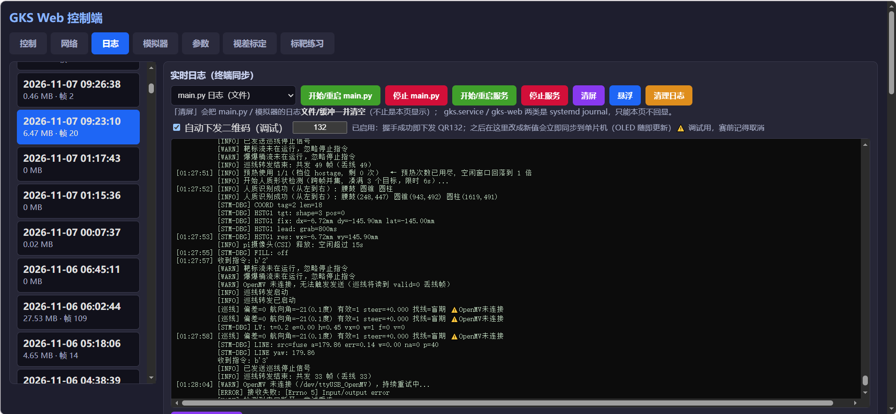
      <br><sub>日志区：运行日志与调试</sub>
    </td>
  </tr>
</table>

### 固件侧

- `map.c` 是纯数据，`vScriptRun` 是执行器；改路线只动表。
- 6 路 UART 全部 DMA 收发。接收侧有 IDLE 卡死检测、错误回调、5 s 重装三层兜底，发送侧是 DMA 环 + TC 中断链。
- 跨模块共享状态统一放在 `app_beam.c`，外部只能通过 getter/setter 访问，不在各模块头文件里加裸 `extern`。
- 业务 1 ms 中断只做舵机平滑和按键扫描，角度 PID 由独立任务以 50 ms 周期运行。
- 中断优先级、临界区里能不能发串口、哪些 HAL 函数不能在 ISR 里调，这些规则都写在 `电控/GongKeCompetition/CLAUDE.md` 里。

## 📁 目录结构

| 目录 | 内容 |
|---|---|
| `电控/` | STM32F407 固件（CubeMX + FreeRTOS + QEPack 驱动）、Web 控制台、固件专题文档 |
| `视觉/PI/` | 树莓派视觉工程 `GKS_Competition` 和 Web 端 `GKS_Web` |
| `视觉/OPENMV/` | OpenMV 侧装巡线程序 |
| `训练/` | 人质 YOLOv8 训练脚本与数据集、OpenMV 巡线训练工具、调试记录 |
| `模型/` | SolidWorks / STEP / 3MF 结构模型、赛场地图与变式图 |
| `PCB/` | 集成板 EasyEDA 工程与原理图 |
| `文档/` | 赛项命题、评分标准、竞赛日程、设计报告与工程图 |
| `现场/` | 决赛文档与现场资料 |

## 🔧 硬件

| 部分 | 型号 / 说明 |
|---|---|
| 主控 | STM32F407VET6 @168 MHz，FreeRTOS V11.3.0 |
| 视觉 | Raspberry Pi（Python 3 + OpenCV + YOLOv8n ONNX） |
| 巡线 | OpenMV，侧装，按需发送文本帧 |
| 相机 | 2 路 USB 1080p（主摄 / 扫码）+ 1 路 CSI OV5647（固定视角打靶） |
| 底盘 | 100 mm 麦克纳姆轮 ×4，EMM42 V5 闭环步进 |
| 机械臂 | 六轴机械臂，多路舵机驱动 |
| 电源 | 9000 mAh 锂电池 |
| 交互 | OLED 菜单、实体按键、蓝牙、Web 控制台 |

## 🚀 运行

### 固件

直接用仓库里的 Keil 工程：

```text
电控/GongKeCompetition/MDK-ARM/GongKeCompetition.uvprojx
```

用 Keil MDK5（ARMCC V5.06）打开后编译下载。命令行编译：

```bash
cd 电控/GongKeCompetition/MDK-ARM
UV4.exe -b GongKeCompetition.uvprojx -j0 -o build.log
```

UV4 的退出码不反映编译成败，需要看日志最后一行的 `N Error(s)`。

**不要用 CubeMX 重新生成这个工程。** 工程里有一部分配置不是 CubeMX 生成的，例如手写的 TX DMA 流、TIM9 补光灯 PWM、部分中断优先级，以及 MiscControls 里的 `--locale=C --diag_suppress=870`。重新生成会把这些配置冲掉，表现为串口、补光灯或舵机异常。CubeMX 只用来改 `.ioc` 里的外设初始化；改完把新增代码同步进现有工程，不要覆盖 `uvprojx`。

### 树莓派视觉

```bash
# udev 规则：按芯片版本号区分两个 CH340，换插口也不会认错
sudo cp 视觉/PI/GKS_Competition/99-gks-devices.rules /etc/udev/rules.d/
sudo udevadm control --reload-rules && sudo udevadm trigger

# 依赖与启动
sudo apt install python3-opencv python3-numpy python3-serial
cd 视觉/PI/GKS_Competition
python3 main.py

# 开机自启
sudo cp gks.service /etc/systemd/system/
sudo systemctl daemon-reload && sudo systemctl enable --now gks.service
```

现场参数以 `config_override.json` 为准，`config.py` 里的出厂值只作参考。

### Web 控制台

```bash
# Windows 下直接双击
电控/GongKeCompetition/webconsole.bat

# 或者手动启动
python 电控/GongKeCompetition/tools/webconsole/server.py
```

浏览器打开 `http://localhost:8410`。具体功能见上面的「实现说明」。

控制台没有鉴权，并且绑定在 `0.0.0.0`，方便局域网内队友一起调试。只建议在可信网络里使用；如果场地网络不可控，把 `server.BIND_HOST` 改成 `127.0.0.1`。

### OpenMV

用 OpenMV IDE 打开 `视觉/OPENMV/main.py`，连接相机后运行。OpenMV 默认不发数据，收到树莓派的 `G` 后开始输出 `L,<offset>,<angle>,<valid>` 文本帧，收到 `S` 停止。

## 📚 文档

| 文档 | 内容 |
|---|---|
| [`电控/GongKeCompetition/CLAUDE.md`](电控/GongKeCompetition/CLAUDE.md) | 固件全局规则、目录结构、中断与并发、脚本设计 |
| [`电控/GongKeCompetition/tools/webconsole/CLAUDE.md`](电控/GongKeCompetition/tools/webconsole/CLAUDE.md) | Web 控制台 11 个 Tab 的实现细节 |
| [`电控/GongKeCompetition/docs/`](电控/GongKeCompetition/docs/) | 13 篇专题：UART、Pi 链路、蓝牙、巡线、标靶、抓取、看路、OLED、传感器、底盘、控制台元数据、审查记录 |
| [`视觉/PI/GKS_Competition/CLAUDE.md`](视觉/PI/GKS_Competition/CLAUDE.md) | 树莓派端相机租约、CSI 持有、任务线程、链路自愈 |
| [`视觉/PI/GKS_Competition/docs/串口协议.md`](视觉/PI/GKS_Competition/docs/串口协议.md) | 双端串口帧协议：命令表、结果帧、CRC 与 Tag 分配 |
| [`视觉/PI/GKS_Web/CLAUDE.md`](视觉/PI/GKS_Web/CLAUDE.md) | Web 端：预览、参数页、模拟器、WiFi 切换 |
| [`文档/设计报告/设计报告.pdf`](文档/设计报告/设计报告.pdf) | 赛项设计报告 |

## 📄 License

本项目基于 [Apache License 2.0](LICENSE) 开源。

## 🗯写在最后

这里借用工创赛项目Logistics_Vehicle的一句话：

*创新是时代赋予你们的神圣使命，别害怕打破传统的枷锁，以果敢的决心冲破陈规陋习，用全新的视角看待问题，敢于在别人未涉足之地留下你们的足迹。我们留下的经验、智慧以及未竟的事业，都是给你们的礼物。希望你们能在这片土地上肆意挥洒汗水，自由驰骋，发挥出你们独特的创造力与才华，开拓出属于你们自己的辉煌天地*
